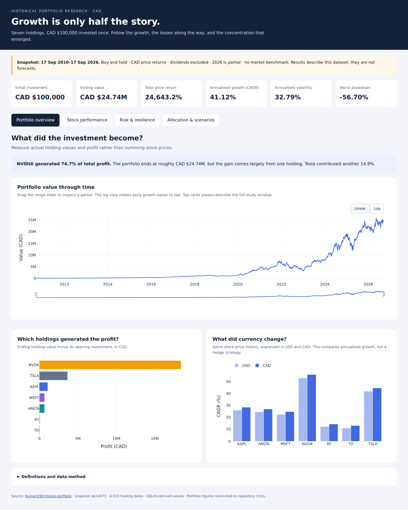
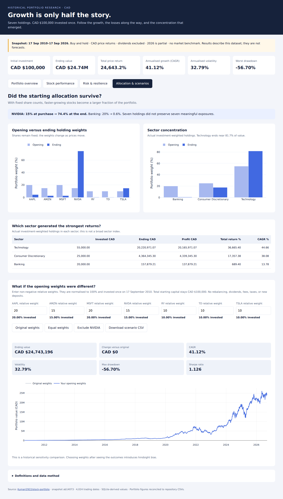

<h1 align="center">Stock Portfolio Performance Analysis</h1>

<p align="center">
  <b>What happens to a CAD $100,000 portfolio left alone for sixteen years?</b><br>
  An end-to-end finance analytics project — from raw market data to an interactive dashboard.
</p>

<p align="center">
  
  
  
  
  
  
</p>

<p align="center">
  <a href="dashboards/stock_portfolio_dashboard.html"><b>Interactive dashboard</b></a> ·
  <a href="reports/findings.md">Findings</a> ·
  <a href="reports/metric_reports.md">Metrics</a> ·
  <a href="reports/project_review.md">Project review</a> ·
  <a href="#the-team">Team</a>
</p>

<p align="center">
  
</p>

---

## The problem

An investor puts CAD $100,000 into seven well-known stocks and does not touch it for sixteen years.

At the end they have a number. **That number alone is close to useless.** It does not say where the
money actually came from, how much risk was carried to earn it, how far the portfolio fell along the
way, or whether the strategy they thought they were running is the one that actually ran.

Answering those questions is a data problem, and it is the same one any finance team faces about its
own book: *we were up X% — now explain it.*

## How we solved it

We scoped the business questions **first**, then built a pipeline that answers each one with
evidence that can be traced back to a raw file.

```
Scope & KPIs → Collect → Clean & validate → Explore → Metrics → SQL database → SQL analysis → Dashboards
```

| # | Step | Output |
|:-:|---|---|
| 1 | Define objective, KPIs, business questions | [Project scope](KPIs%20and%20Business%20Questions/Project_Scope_QA.pdf) |
| 2 | Collect market data | 8 daily OHLCV files + Bank of Canada FX ([sources](data/raw/SOURCES.md)) |
| 3 | Clean & validate | 46,341 → 31,013 rows, all in CAD ([quality report](reports/data_quality_report.md)) |
| 4 | Exploratory analysis | [9 charts + 8 findings](reports/findings.md) |
| 5 | Financial metrics | [Portfolio & per-stock KPIs](reports/metric_reports.md) |
| 6 | SQL database | SQLite: `Stock_Prices`, `Company_Master`, `Portfolio` |
| 7 | SQL analysis | [4 views + 16 queries](SQL/kpi_analysis.sql) ([report](reports/sql_kpi_report.md)) |
| 8 | Dashboards | [4-page interactive](dashboards/stock_portfolio_dashboard.html) + Power BI |

**The portfolio.** CAD $100,000 invested once on 17 September 2010, held to 17 September 2026,
never rebalanced:

`AAPL 20%` · `MSFT 20%` · `NVDA 15%` · `AMZN 15%` · `TSLA 10%` · `RY 10%` · `TD 10%`

Sixteen years was a deliberate choice — long enough to contain multiple market cycles, so the
result cannot be a lucky window.

---

## The KPIs, answered

All figures in CAD, price returns, 4,024 trading days.

| KPI | Result |
|---|---:|
| Total investment | **CAD $100,000** |
| Current portfolio value | **CAD $24,743,196** |
| Profit / loss | **+CAD $24,643,196** |
| Total return | **+24,643%** (247.4×) |
| Annualised return (CAGR) | **41.1%** |
| Portfolio growth rate (avg calendar year) | **48.6%** |
| Portfolio volatility | **32.8%** |
| Sharpe ratio (3% risk-free) | **1.13** |
| Maximum drawdown | **−56.7%** (5 Jan 2023) |
| Best performing stock | **NVDA** (+122,697%) |
| Worst performing stock | **TD** (+621%) |
| Sector-wise return | Technology **+36,665%** · Consumer Disc. **+17,357%** · Banking **+689%** |
| Return by stock | [Full table →](reports/metric_reports.md#3-stock-performance-summary) |
| Average daily trading volume | NVDA 464M · AAPL 216M · TSLA 95M · TD 2.0M · RY 1.2M |

### The ten business questions

| Question | Answer |
|---|---|
| 1. Highest return? | **NVDA**, +122,697% (56.0% CAGR) |
| 2. Highest risk? | **TSLA** — 56.5% volatility, −71.1% drawdown |
| 3. Overall portfolio return? | **+24,643%**, 41.1% CAGR |
| 4. Best sector? | **Technology** — 81.8% of all profit |
| 5. Biggest contributor to growth? | **NVDA** — 74.7% of total profit |
| 6. How did prices change? | [Indexed growth](reports/figures/01_indexed_growth.png) |
| 7. Consistent outperformers? | **Not answerable** — no market benchmark in scope |
| 8. Effect of major market events? | 2022 is the only year **all seven** fell |
| 9. Best risk-return balance? | **NVDA** (Sharpe 1.15), then AAPL (0.94) |
| 10. Does allocation matter? | Less than stock selection — [test it live](dashboards/stock_portfolio_dashboard.html) |

---

## What the data actually said

> ### 1. The result is one stock
> NVIDIA was bought at **15%** of the portfolio and ended at **74.4%** of it, producing
> **74.7% of all profit**. With Tesla, roughly **90%**. Any claim that "this allocation worked" is
> really a claim about one holding.

> ### 2. The allocation being tested stopped existing
> Apple and Microsoft were the two *largest* opening positions at 20% each. They finished at
> **4.5%** and **2.8%**. The two banks went from **20% → 0.6%** combined. Nothing was ever sold —
> buy-and-hold did this alone. The 41.1% CAGR describes a concentrated NVIDIA position, not the
> allocation as written.

> ### 3. Diversification was weaker than seven names suggests
> RBC and TD correlate at **0.79** — 20% of the opening portfolio for roughly one bet on Canadian
> banking. The portfolio behaved like three blocks, not seven holdings.

> ### 4. Currency was the third-largest driver of the result
> USD/CAD rose **35.4%** over the window, adding **+2.1 to +2.9 points** to every holding's annual
> return *and lowering* every volatility and drawdown figure. For a Canadian holder of US equities,
> the exchange rate was not a rounding error.

> ### 5. Every holding survived a fall of at least 34%
> The headline returns required holding through drawdowns from −34% to −71%. Both banks bottomed on
> the same day: **23 March 2020**.

[Read all eight findings →](reports/findings.md)

---

## Explore it yourself

**Interactive dashboard** — four pages, runs offline in any browser:

```bash
git clone https://github.com/Kumari2922/stock-portfolio.git
open stock-portfolio/dashboards/stock_portfolio_dashboard.html
```

<p align="center">
  
</p>

The **Allocation & scenarios** page re-runs all sixteen years of daily prices against weights you
choose, live — including a one-click *Exclude NVIDIA* preset. GitHub's file viewer will not execute
it; download the repo and open the file.

**Reproduce the whole pipeline:**

```bash
pip install -r requirements.txt
python python/clean_data.py          # raw → clean, USD → CAD
python python/eda.py                 # charts + metric tables
python python/performance_metrics.py # portfolio & stock KPIs
python python/load_to_database.py    # build SQLite + views
```

All three Python stages re-run byte-identically from the committed state.

---

## Repository map

| Path | What's in it |
|---|---|
| [`python/`](python) | The pipeline — cleaning, EDA, metrics, database loader, shared config |
| [`SQL/`](SQL) | [`views.sql`](SQL/views.sql) (4 reusable views), [`kpi_analysis.sql`](SQL/kpi_analysis.sql) (16 queries) |
| [`dashboards/`](dashboards) | Interactive dashboard, Power BI build kit, [project walkthrough](dashboards/PROJECT_EXPLAINED.md) |
| [`reports/`](reports) | [Data quality](reports/data_quality_report.md) · [Findings](reports/findings.md) · [Metrics](reports/metric_reports.md) · [SQL KPIs](reports/sql_kpi_report.md) · [Review](reports/project_review.md) |
| [`data/raw/`](data/raw) | Source files, unedited, with [provenance](data/raw/SOURCES.md) |
| [`data/processed/`](data/processed) | Clean dataset, metric tables, SQLite database |

---

## Method and limitations

Stated up front, because a number without its caveats is a liability.

**Method.** Prices are US listings converted to CAD at the Bank of Canada daily rate (two BoC series
spliced at 2017-01-03, validated across their 82-day overlap — they agree to 0.081%). Share counts
are fixed at purchase; portfolio value is `Σ shares × close`. The original USD price and the rate
used are retained on every row, so every conversion is auditable.

**Limitations.**

- **Survivorship bias.** These seven tickers were chosen in 2026, with the outcome already known.
  This measures what the allocation *would have produced* — not that it was a sound choice in 2010.
- **Price returns only.** No dividend-adjusted series exists in the source, which understates RY
  and TD most as the two highest-yielding holdings.
- **No benchmark.** Nothing here establishes whether any holding beat the market.
- **Assumptions are labelled.** The 3% risk-free rate, the 20%/35% risk-level cut-offs and the
  ranking rule are choices, not standards. Component columns are kept so another rule can be applied.
- **2026 is partial**, running to 17 September.

This is a historical study for portfolio and educational purposes. **It is not investment advice.**

**Verification.** Every SQL figure was reconciled field-by-field against the Python outputs —
**60 of 60 cross-checks agree** ([report](reports/sql_kpi_report.md)). A full internal review of the
repository is published at [`reports/project_review.md`](reports/project_review.md), including two
defects it caught and how they were fixed.

---

## The team

Four analysts, one repository, one week of sprint.

| | Contribution |
|---|---|
| **[@Kumari2922](https://github.com/Kumari2922)** | Project scope, KPIs & business questions · data collection · SQLite database · SQL analysis · Power BI dashboard |
| **Samir Omer** | Data cleaning & validation · exploratory analysis · SQL KPI layer & views · project review |
| **[@KiranGill08](https://github.com/KiranGill08)** | Financial performance metrics — portfolio value, CAGR, Sharpe, drawdown, weights, contribution to growth |
| **[@AshishSachdev](https://github.com/AshishSachdev)** | Sprint framework & project standard · interactive dashboards · Power BI build kit |

Built to the [5-day sprint roadmap](team-related/Stock_Portfolio_Analysis_5Day_Roadmap.pdf) and the
[project standard](team-related/Generalized_2_Projects_Per_Week_Data_AI_Sprint.md).
